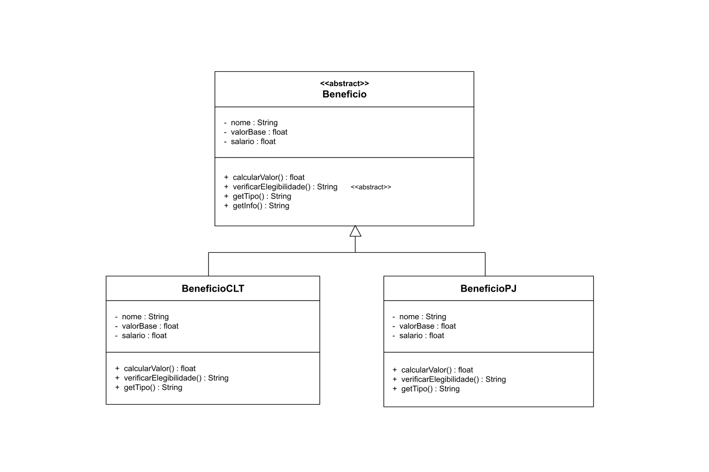

# Padrão de Projeto: Template Method (Sistema de RH)

Projeto em Java exemplificando a aplicação do padrão comportamental **Template Method** no contexto de um sistema de benefícios de Recursos Humanos para a disciplina DCC078-2026.3-A - Aspectos Avançados em Engenharia de Software.

## Diagrama de Classes UML

## Padrão Utilizado

O padrão **Template Method** é utilizado na classe abstrata `Beneficio`, que define uma estrutura comum para a apresentação das informações dos benefícios. O método `getInfo()` organiza a obtenção do tipo, do valor calculado e da elegibilidade, enquanto as subclasses implementam suas próprias regras de elegibilidade.

As classes `BeneficioCLT` e `BeneficioPJ` especializam o comportamento da classe abstrata, definindo critérios de elegibilidade e identificações específicas para cada tipo de contrato.

## Estrutura

- `Beneficio`: classe abstrata que define os atributos e comportamentos comuns, além do método `getInfo()`, que organiza a apresentação das informações.
- `BeneficioCLT`: implementação concreta para benefícios associados a contratos CLT.
- `BeneficioPJ`: implementação concreta para benefícios associados a contratos PJ.
- `BeneficioCLTTest`: classe de testes para verificar a elegibilidade e as informações dos benefícios CLT.
- `BeneficioPJTest`: classe de testes para verificar a elegibilidade e as informações dos benefícios PJ.

## Testes

Os testes verificam:

- elegibilidade de benefícios CLT;
- inelegibilidade de benefícios CLT;
- apresentação das informações dos benefícios CLT;
- elegibilidade de benefícios PJ;
- inelegibilidade de benefícios PJ;
- apresentação das informações dos benefícios PJ.

Ao todo, são **6 testes automatizados**, utilizando JUnit 5.
